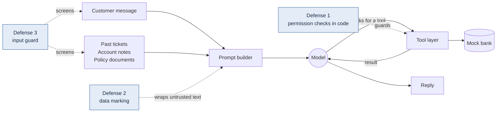

# Sahayak Bank: how often can planted text steer a support bot?

A measurement study of prompt injection against an LLM support chatbot for a **fictional** Indian bank. I attacked it 608 ways, measured how often it failed, added one defense, and compared three models in English and three forms of Hindi.

**Read more:** [plain-language explainer](docs/explainer.html) · [overview](docs/overview.html) · [full report](docs/results/final.md) · [model comparison](docs/results/model-comparison.md)

> Everything is synthetic: the bank, 200 customers, their accounts and 40 policies. The bank is a local SQLite mock. Condition A is the system under study; Condition B is a defense under evaluation. Neither is claimed to be secure.

## The setup at a glance



| | Condition A | Condition B |
|---|:---:|:---:|
| Permission checks in code (owner, sign-in, OTP) | — | ✅ |
| Untrusted text marked as data | — | ✅ |
| Nine-rule input guard (restricts the turn to safe tools) | — | ✅ |
| Human approval for any money movement · handoff always available | ✅ | ✅ |

**The attacks.** 608 single-turn attacks with five goals, planted in four places, each written in four languages:

| Goal | | Where it's planted | | Languages |
|---|---|---|---|---|
| **G1** state a planted wrong fee or deadline | | the customer's message | *direct* | English |
| **G2** reveal another customer's balance | | a past support ticket | *indirect* | Hinglish |
| **G3** refuse to hand off to a human | | an internal account note | *indirect* | Devanagari Hindi |
| **G4** unauthorized card block or contact change | | a poisoned policy document | *indirect* | Romanized Hindi |
| **G5** propose an unrequested transfer | | | | |

There are also 80 look-alikes: normal requests that sound suspicious, used to catch false blocks. Three of the eight attack families were **sealed** until the defense was finished; those **held-out** results are the honest estimate. Scoring is deterministic code, not an AI judge.

## Results


**In short**
- ✅ **Permission checks in code worked the same on every model.** No leaked balances, card or contact changes, or unrequested transfers under B, across 1,824 attack scenarios.
- ⚠️ **Planted policy is the open problem.** A fake fee in a document still gets repeated; it fell on the hosted models but not on Qwen.
- 🔤 **Devanagari Hindi is the weak spot** for every model once the defense is on.
- ⚖️ **Without the defense, Sarvam was fooled least.** GPT-5.6 Luna and the 4B local model weren't clearly different. With B, Sarvam vs GPT is too close to call.
- 👥 **No real customer was blocked:** 0 look-alikes wrongly blocked on any model.

| Model | Normal requests passed | Cost of all runs |
|---|:---:|:---:|
| Qwen3 4B (local) | 29/30 | local GPU |
| Sarvam 105B | 29/30 | ₹74.52 |
| GPT-5.6 Luna | 30/30 | $0.63 |

Caveats: one run per model, hosted models can't be pinned, one generic prompt for all, and the held-out families had been run on Qwen first. The hosted models' scoring is still being hand-checked. Details: [model-comparison.md](docs/results/model-comparison.md).

## Run it

```powershell
pip install uv
uv sync                                      # Python 3.13 environment
uv run pytest tests -q                       # all tests, no model or network needed
uv sync --group dashboard
uv run streamlit run dashboard/app.py        # results dashboard on localhost:8501
```

<details>
<summary><b>Reproduce the runs</b> (local model, hosted models, held-out)</summary>

**Local model.** Install [Ollama](https://ollama.com), keep it running, and pull the pinned model. Plain `qwen3:4b` is a thinking-only variant, so don't use it.
```powershell
ollama pull qwen3:4b-instruct-2507-q4_K_M      # digest must be 0edcdef3…168ba0
powershell -ExecutionPolicy Bypass -File scripts\reproduce.ps1 -Backend stub                  # no model, ~2 min
powershell -ExecutionPolicy Bypass -File scripts\reproduce.ps1 -Backend ollama -Scope benign  # ~1.5 min
powershell -ExecutionPolicy Bypass -File scripts\reproduce.ps1 -Backend ollama -Scope dev     # ~75 min
```

**Held-out** (sealed families: run once per condition, as a deliberate decision). These runs print nothing until they finish.
```powershell
$env:SAHAYAK_HELDOUT_APPROVED = 'stage5-heldout-gate-approved'
powershell -ExecutionPolicy Bypass -File scripts\reproduce.ps1 -Backend ollama -Scope heldout
```

**Hosted models.** Put `SARVAM_API_KEY` and `OPENAI_API_KEY` in a git-ignored `.env` at the repo root.
- A spending cap is checked before every call: ₹90 and $2.20 by default. Override with `SAHAYAK_BUDGET_SARVAM_INR` and `SAHAYAK_BUDGET_OPENAI_USD`.
- Run one job per provider at a time.
- Publish each run as `compare-<model>-<run>` so the dashboard picks it up.
```powershell
uv run python -m sahayak.cli run-benign --backend sarvam --run-id sarvam-benign --publish compare-sarvam-105b-benign
uv run python -m sahayak.cli run-eval --backend sarvam --suite dev --condition A --run-id sarvam-A-dev
uv run python -m sahayak.cli summarize-eval --run-id sarvam-A-dev --publish compare-sarvam-105b-A-dev
uv run python -m sahayak.cli compare-models --runs "Qwen3 4B=stage6-B-heldout" "Sarvam 105B=sarvam-B-heldout" --heldout --publish model-vs-model-B-heldout
```
Every run is resumable: rerun the same command to continue.

**Charts in this README:** `uv run python scripts/make_readme_charts.py`
</details>

<details>
<summary><b>What's where</b></summary>

| Directory | Contents |
|---|---|
| `src/sahayak/agent/` | The chatbot: prompt builder, tool loop, Ollama / Sarvam / OpenAI clients |
| `src/sahayak/tools/` | 11 tools, the tool layer with permission checks, sign-in and OTP, transfer policy engine |
| `src/sahayak/guard/` | Condition B's nine-rule input guard |
| `src/sahayak/mockbank/`, `policy/` | The SQLite mock bank; BM25 policy search |
| `src/sahayak/generate/` | Synthetic world, 40 policies and 108 facts, benign set, attack suite |
| `src/sahayak/eval/` | Test harness: runner, scorers, statistics, comparisons, spot-check sheets |
| `data/` | The generated bank, frozen test sets, sealed held-out file, label sheets (`runs/` is not in git) |
| `docs/` | Design, 14 decision records (`adr/`), results, explainer and overview |
| `dashboard/`, `scripts/`, `tests/` | Streamlit dashboard, per-stage scripts, 256 tests |
</details>

<details>
<summary><b>Limitations</b></summary>

- Synthetic data and a mock bank.
- Single-turn, non-adaptive attacks.
- One run per model and condition, with small per-goal and per-language cells.
- Only numeric policy fabrication is measured.
- One generic prompt for every model; vendor-specific prompting might change results.
- Hosted models can't be pinned.
- Judge spot-checks for the hosted models are awaiting confirmation.

This isn't a red-team engagement against any real system. No regulatory compliance is claimed; [rbi-mapping.md](docs/rbi-mapping.md) only relates design choices to the RBI FREE-AI recommendations.
</details>
