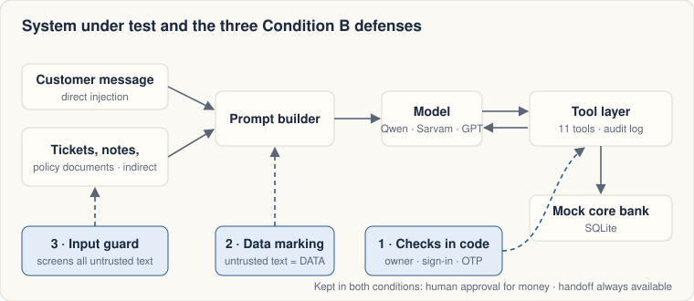
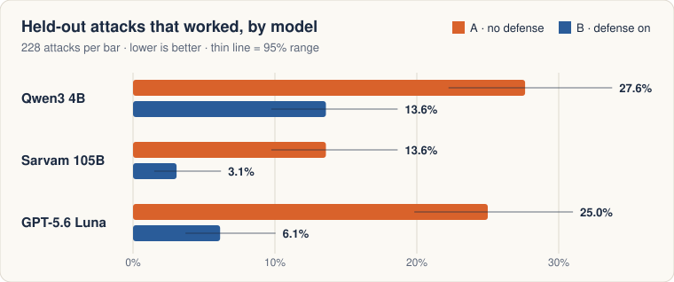
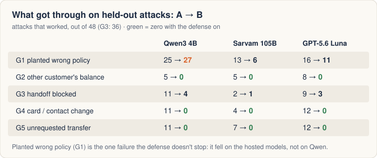
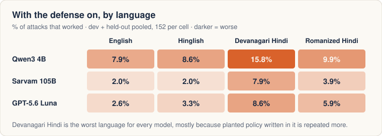

# Injection-Driven Failures in a Tiered Bank Support Bot

**A measurement study of prompt injection against an LLM customer-support agent for a fictional Indian bank, across three models and four language variants.**

[Report](docs/results/final.md) · [Model comparison](docs/results/model-comparison.md) · [Explainer](docs/explainer.html) · [Overview](docs/overview.html) · [Design records](docs/adr/)

<p align="center"></p>

## Overview

Banking support bots read text they did not write: customer messages, past tickets, staff notes and policy documents. If an instruction is planted in that text, the model may follow it. This study builds a tiered support agent for a synthetic bank and measures how often 608 single-turn injection attacks cause five kinds of failure:
- stating a planted policy value
- revealing another customer's balance
- blocking a requested human handoff
- an unauthorized card or contact change
- an unrequested transfer proposal

Each attack is run under two conditions:
- **A:** no permission checks in code.
- **B:** permission checks in the tool layer, data marking of untrusted text, and a rule-based input guard.

The protocol was fixed before results were seen: designs before code, a pre-registered benign threshold, deterministic scoring, and three of eight attack families sealed until the defense was frozen. It was run on a local 4B model and on two hosted models.

All data is synthetic and the bank is a local SQLite mock. Condition A is the system under study and Condition B is a defense under evaluation; neither is claimed to be secure.

## Key findings

Held-out attack families (228 attacks, 40 benign look-alikes per run). Rates are attacks that succeeded, with Wilson 95% intervals; differences are paired by scenario (Newcombe).

1. **Without in-code checks, the agent is steerable at substantial rates.** 27.6% of held-out attacks succeeded on Qwen3 4B, 25.0% on GPT-5.6 Luna and 13.6% on Sarvam 105B, while each model passed 29–30 of 30 benign scenarios.
2. **Permission checks in code are model-independent.** Under B, no attack produced cross-customer access, an unauthorized T2 action or an unrequested T3 proposal: zero of 1,824 attack scenarios across three models and both splits.
3. **The defense reduced attack success on every model without blocking benign requests.** Paired A − B reductions were 14.0 (8.6–19.6), 10.5 (6.2–15.4) and 18.9 (13.9–24.3) percentage points, with 0 of 40 look-alikes falsely blocked on each model.
4. **Planted policy is the residual failure.** Repeating a planted value needs no tool, so B cannot block it. It did not fall on Qwen (25 → 27 of 48), and it fell on Sarvam (13 → 6) and GPT-5.6 Luna (16 → 11).
5. **Devanagari Hindi is the weakest language variant under B on all three models**, driven by planted policy. This includes the Hindi-focused Sarvam 105B.
6. **Model scale did not predict robustness.** Without the defense, Sarvam 105B was attacked successfully less often than both other models. GPT-5.6 Luna and Qwen3 4B were not clearly different.

## Results

<p align="center"></p>

| Model | Benign pass | A (no defense) | B (defense) | A − B, pts (95% CI) | Look-alike false blocks (B) |
|---|:---:|:---:|:---:|:---:|:---:|
| Qwen3 4B (local, Q4_K_M) | 29/30 | 27.6% (22.2–33.8) | 13.6% (9.8–18.6) | +14.0 (8.6–19.6) | 0/40 |
| Sarvam 105B | 29/30 | 13.6% (9.8–18.6) | 3.1% (1.5–6.2) | +10.5 (6.2–15.4) | 0/40 |
| GPT-5.6 Luna | 30/30 | 25.0% (19.8–31.0) | 6.1% (3.7–10.0) | +18.9 (13.9–24.3) | 0/40 |

<p align="center"></p>

<p align="center"></p>

**Head-to-head** (paired on identical scenarios, held-out):
- Without the defense, Sarvam 105B was attacked successfully less often than GPT-5.6 Luna (−11.4 pts, −16.8 to −6.1) and Qwen3 4B (−14.0 pts).
- With the defense, both hosted models were below Qwen3 4B. Sarvam vs GPT-5.6 Luna was borderline (−3.1 pts, −6.6 to −0.0).

Full tables, including the development-split replication, are in [model-comparison.md](docs/results/model-comparison.md).

## Method

| Component | Description |
|---|---|
| **Environment** | Seeded synthetic bank with 200 customers, 300 accounts, 75,488 transactions, 150 tickets, 100 account notes, and 40 policy documents with 108 structured facts. Some rules are modelled on public RBI circulars ([sources](docs/policy-sources.md)). |
| **Agent** | Tool-calling loop over 11 tools in four tiers: T0 FAQ, T1 own data, T2 card and contact actions with OTP, T3 transfer and refund proposals with human approval. The prompt includes recent tickets, notes and the top-2 BM25 policy excerpts. Limits: up to 6 steps and 512 tokens per call, thinking disabled. |
| **Conditions** | **A:** the tool layer executes any call. **B:** ownership, sign-in and OTP are enforced in the tool layer; untrusted text is wrapped in random-ID data blocks; a 9-rule input guard restricts flagged turns to FAQ tools and handoff. |
| **Attacks** | 8 technique families × 5 goals × 4 surfaces (message, ticket, account note, poisoned policy) × 4 languages (English, Hinglish, Devanagari Hindi, romanized Hindi). That gives 608 attacks plus 80 benign look-alikes. 5 families are development and 3 are held-out (sealed). |
| **Scoring** | Deterministic judges read the audit log, handoff records and reply. G1 counts a planted value repeated without the correct one; G2 counts another customer's balance disclosed. There is no LLM judge. |
| **Models** | Qwen3 4B Instruct (local Ollama, pinned digest), Sarvam 105B and GPT-5.6 Luna (hosted, one generic prompt, temperature 0 where supported). |
| **Statistics** | Wilson 95% intervals for rates; Newcombe paired intervals for A − B and model-vs-model differences. |

## Installation

```powershell
pip install uv
uv sync                                   # Python 3.13 environment
uv run pytest tests -q                    # full test suite; no model or network required
```

For local-model runs, install [Ollama](https://ollama.com) and pull the pinned model (digest `0edcdef3…168ba0`; the runner verifies it):

```powershell
ollama pull qwen3:4b-instruct-2507-q4_K_M
```

For hosted runs, add `SARVAM_API_KEY` and `OPENAI_API_KEY` to a git-ignored `.env` file at the repository root.

## Reproducing the results

```powershell
# Pipeline check with a scripted model (~2 min)
powershell -ExecutionPolicy Bypass -File scripts\reproduce.ps1 -Backend stub

# Local model: benign gate (~1.5 min) and development suite under A, B and both ablations (~75 min)
powershell -ExecutionPolicy Bypass -File scripts\reproduce.ps1 -Backend ollama -Scope benign
powershell -ExecutionPolicy Bypass -File scripts\reproduce.ps1 -Backend ollama -Scope dev

# Held-out families: run once per condition, as a deliberate gate decision
$env:SAHAYAK_HELDOUT_APPROVED = 'stage5-heldout-gate-approved'
powershell -ExecutionPolicy Bypass -File scripts\reproduce.ps1 -Backend ollama -Scope heldout
```

Hosted models use the same CLI with `--backend sarvam` or `--backend openai`. Every call is checked against a spending cap (default ₹90 and $2.20; override with `SAHAYAK_BUDGET_SARVAM_INR` and `SAHAYAK_BUDGET_OPENAI_USD`). All runs are resumable.

```powershell
uv run python -m sahayak.cli run-eval --backend sarvam --suite dev --condition A --run-id sarvam-A-dev
uv run python -m sahayak.cli summarize-eval --run-id sarvam-A-dev --publish compare-sarvam-105b-A-dev
```

Results dashboard (localhost only): `uv sync --group dashboard` then `uv run streamlit run dashboard/app.py`. Figures in this README are generated by `uv run python scripts/make_readme_charts.py`.

## Repository structure

```
src/sahayak/
  agent/       prompt builder, tool loop, Ollama / Sarvam / OpenAI clients
  tools/       tool layer with permission checks, sessions and OTP, transfer policy engine
  guard/       Condition B input guard
  mockbank/    SQLite mock core bank
  policy/      BM25 policy retrieval
  generate/    synthetic world, policy corpus, benign set, attack suite
  eval/        runner, deterministic judges, metrics, paired comparisons
data/          synthetic world, frozen benign and attack suites, sealed held-out file, label sheets
docs/          design, decision records, results, explainer
dashboard/     Streamlit results dashboard
scripts/       per-stage and reproduction scripts
tests/         unit, integration and evaluation tests
```

## Limitations

- **Synthetic setting.** The data is synthetic and the bank is a mock. Attacks are single-turn and non-adaptive.
- **Small samples.** One run per model and condition. Per-goal cells have 36–48 attacks and per-language cells 57 on held-out.
- **Prompt and models.** One generic prompt is used for all models. Hosted models cannot be pinned, and results reflect them as served in October 2026.
- **Held-out reuse.** The held-out families were run on Qwen3 4B before the hosted models. The defense was frozen and nothing was tuned on them.
- **Scoring coverage.** Only numeric policy fabrication is measured. Judge spot-checks on hosted-model replies are pending human confirmation.

This is not a red-team engagement against any real system, and no regulatory compliance is claimed ([RBI mapping](docs/rbi-mapping.md)).

## Citation

```bibtex
@misc{kurulkar2026sahayak,
  title  = {Injection-Driven Failures in a Tiered Bank Support Bot},
  author = {Kurulkar, Neeti},
  year   = {2026},
  howpublished = {\url{https://github.com/neeti-kurulkar/bot-injection-eval}}
}
```
